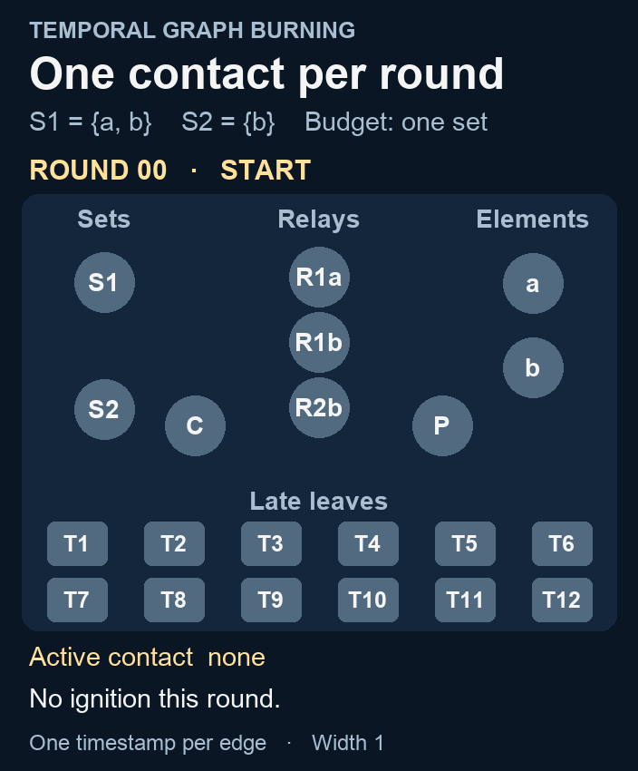

# Temporal graph burning at edge-interval-membership width one

  

Hand asked whether Temporal Graph Burning becomes tractable when few edge lifetimes overlap. It stays NP-complete even on a connected underlying graph with one appearance per edge and a distinct timestep for every edge. This gives para-NP-completeness for edge-interval-membership width alone.

[Read the paper](paper/manuscript.pdf) · [LaTeX source](paper/manuscript.tex) · [Proof outline](proof/PROBLEM_AND_PROOF.md) · [Run the replay](REPRODUCIBILITY.md)

## Watch an actual burning schedule

With a budget of one set, choose S1 = {a, b}. The first two ignitions light the hub and S1. Fire follows one scheduled contact before each subsequent ignition. The chosen set lights its relays, and the relays light a and b. The 12 late leaves have no contact until the decision horizon has passed, so they use 12 of the 14 ignitions.

[Download the offline explorer](https://raw.githubusercontent.com/DannyExperiments/temporal-graph-burning-width-one/c1ab99dda7c4d0e053331f73ec180e0b7564215b/visualization/burning-schedule-explorer.zip), extract it and open `index.html` to step through all 27 timesteps. [Figure guide](visualization/README.md)

## Sources and verification

The problem is in [Hand’s thesis, §6.1](https://doi.org/10.5525/gla.thesis.84865) and [catalog Q72](https://github.com/10m-u/open-problems-catalog/blob/ca8d4d44ba3db527f19f28928c240168f545ecfe/problems/computer_science_ai/theory-of-computation-algorithms-part-1.md#q72). The exact Python replay checks 246 scheduled instances against Set Cover and exercises the extra spread after the last ignition.

[Mathematical audit](audits/public_safe_reports/MATHEMATICAL_AUDIT.md) · [Literature audit](audits/public_safe_reports/LITERATURE_AUDIT.md) · [Scope](CLAIM_SCOPE_AND_LIMITATIONS.md) · [AI disclosure](AI_DISCLOSURE.md) · [Status](STATUS.md)

[Release v1.0.0](https://github.com/DannyExperiments/temporal-graph-burning-width-one/releases/tag/v1.0.0) · [Version DOI](https://doi.org/10.5281/zenodo.24568155) · [Citation](CITATION.cff)
